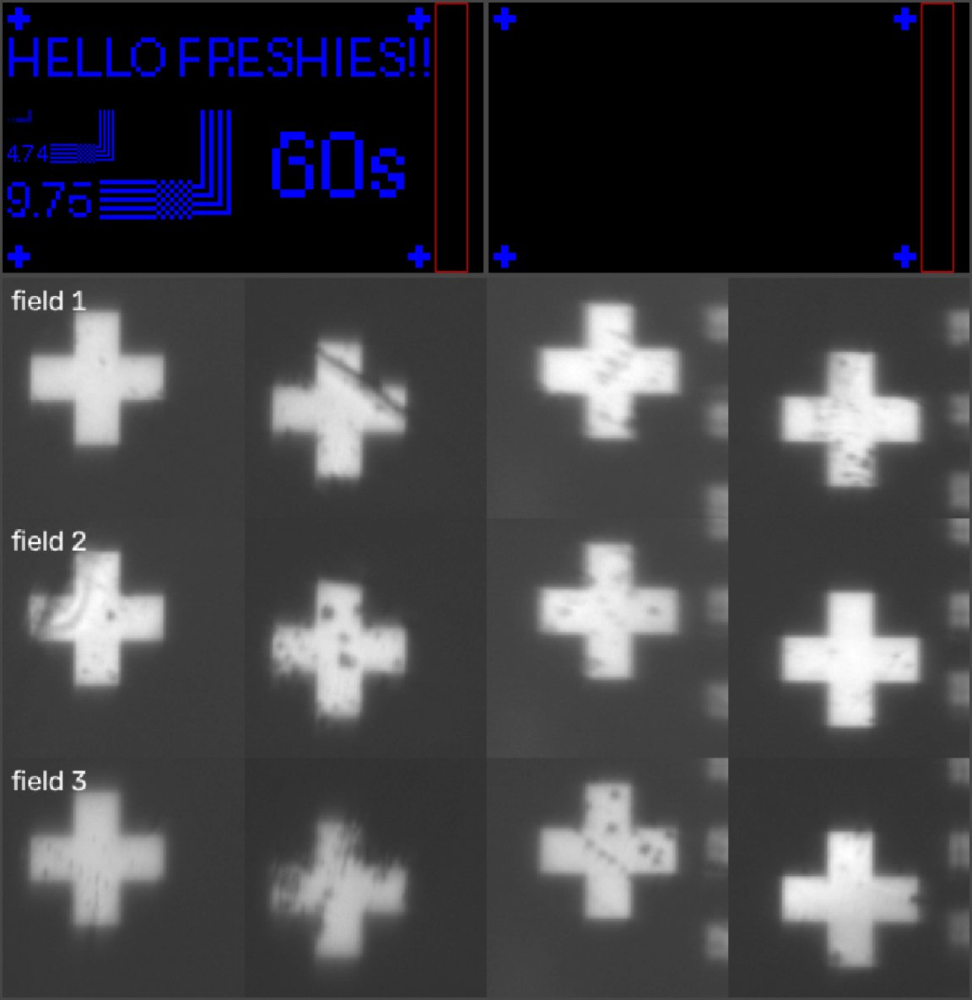

# patterns — images to project, and the code that makes them

Two kinds of thing live here:
- **Images the UI uses directly:**
  - `white_4K.jpg`: the White button;
  - `calibrate_deflicker.png`: Calibrate deflicker;
  - `checker_NNNNpx.png`: 3840×2160 checkerboards, top-left square white,
    the size zero-padded so they sort.
- **Pattern-generation code** (`lib/`, `scripts/`): pixel-perfect patterns
  for the DMD. It comes from the old repo
  [jjbel/patterns-py](https://github.com/jjbel/patterns-py) (commit
  `e80ef2d`), merged in here.

## lib — the pattern library (from patterns-py)

One integer-pixel geometry description produces both:
- **raster PNGs** for the DMD, colourable red / white / blue, with per-pixel
  0–255 intensity for greyscale dose;
- a **vector GDSII** for KLayout.

The raster is the ground truth: a 1 px feature is exactly one pixel, with
no anti-aliasing blur.

- **Coordinates:** integer pixels, origin top-left, x right, y down. GDS
  export centres the origin and flips y.
- **Scale:** the full 3840 px width spans `FIELD_WIDTH_UM` from
  `projector/optics.py`, nominally 1070 µm (0.279 µm/px). patterns-py used
  1100 µm. `Pattern.um(x)` converts microns to the nearest pixel.
- **Builders** (`lib/builders.py`) return `ShapeGroup`s; place them with
  `Pattern.place(group, x, y)`. Available: `box`, `plus_fiducial`,
  `line_array` (its `pitch_factor × line width` is the edge-to-edge gap),
  `checkerboard` (a block of squares), `l_shape` / `nested_ls`, `circle`,
  `circle_grid`, `wafer`, and `text` (bitmap font, crisp at any integer
  scale).
- **Layout** (`lib/layout.py`): `flow_layout` (shelf packing) and
  `tile_quadrants`.
- **Output:**
  - `write_png(pattern, path, color)`; `render_rgb` and `render_bgr` give
    arrays (BGR for OpenCV and `ui/script_client.py`'s `image()`);
  - `preview(pattern)`;
  - `write_gds(pattern, path)`, which also writes a `.cif`. It needs
    KLayout (`pip install klayout`), which isn't installed in the venv, so
    the scripts that write GDS (`make_box`, `res_test_v00`, `step_test`,
    `electroplating_pattern`) stop there for now.
- **Full-field checkerboards:** `checkerboard_image(square, w, h)` draws
  them with numpy (at 1 px squares the `checkerboard` builder would make
  ~4 million boxes). The UI's Checker button and
  `scripts/make_checkerboards.py` both use it; it reproduces the committed
  `checker_*.png` files exactly.

## scripts

Run from the repo root, e.g. `.\.venv\Scripts\python.exe patterns\scripts\res_test_v01.py`.
Output goes to `patterns/out/` (git-ignored), except where noted.

| script | makes |
| --- | --- |
| `make_checkerboards.py [sizes…]` | `patterns/checker_NNNNpx.png` (default 100 200 300) |
| `res_test_v01.py` | nested L's (4, 17, 35 px lines, labelled in µm) and line arrays (17–35 px, gap 4× the width, both orientations), plus fiducials in the four corners |
| `dose_test_patterns.py [t …]` | the dose test's two patterns (`ui/dose_test.py`), in blue: `focus_markers` (four plus fiducials, the right pair moved left of the DMD fault band) and `res_test(t)` (the same fiducials; "HELLO FRESHIES!!" across the top, as big as fits on one line; under it res_test_v01's nested L's with a short reach on the left and the time in big text, "60s", on the right). Everything stays left of the fault band at input x 3456–3712 (mirror columns 1728–1856) |
| `res_test_v00.py` | line arrays 1–10 px and 1–10 µm, checkerboards, tiled in four quadrants (+ GDS) |
| `make_l_test.py`, `make_box.py`, `step_test.py`, `electroplating_pattern.py` | small tests; the electroplating mask (GDS) |
| `live_reload.py [script] [png]` | re-runs a script when lib or the script changes, and shows the PNG in a window |

**Nested L's, `reach`:** `l_shape(reach=…)` / `nested_ls(reach_factor=…)` set
how far the stepped L's run from the checkerboard before turning up (default
`q`, 12× the line width). The dose test uses 2×: the L's are 1785 px wide
instead of 2135.

**The DMD fault band** (2026-10-07): in a camera frame of the markers with
nothing else lit, the band is bright from input x ≈ 3453 to 3712 px. That's
mirror columns 1728–1856, the "1728+" band in projector/README.md. The dose
patterns stay 40 px left of it.

**res_test_v01, changed layout:** as it came from patterns-py, the test
block was 3407 × 2312 px, taller than the 2160 px field. The smallest L was
cut off at the top, and the line arrays ran into the bottom-right fiducial.
It now has the same features, rearranged into 3435 × 1303 px between the
corner fiducials: the 29 and 35 px arrays beside the L's, the 17 and 23 px
arrays under them.

*Top: `res_test(60)` and `focus_markers` as generated (blue), with the DMD
fault band outlined in red. Bottom: the four markers in the camera after
the dose test's autofocus, one row per field of the 3-field check
(2026-10-07, bare wafer, blue LED only). They're sharp, with dust and
scratches on the wafer showing on them; the fault band's bars are at the
right edge, just clear of the right-hand pair.*
