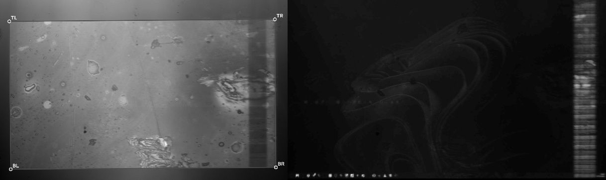

# ui — control UI and server

One page runs the whole setup: stage control, projector display and a
deflickered camera feed. The page and the live feeds come from one Python
process, `server.py`.

```powershell
.\ui\start.ps1
```

That runs the server **in the current terminal**, and opens the UI in a
**Firefox** window of its own as soon as the server answers. Errors and status stay visible in the terminal. The window and the
server live and die together:
- **Ctrl+C** in the terminal, or the server exiting for any reason, closes
  the window;
- **closing the window** stops the server cleanly (`POST /shutdown`), which
  releases the camera and COM4.

Arguments go to `server.py`, e.g. `.\ui\start.ps1 --monitor DISPLAY5`.

The window uses its own Firefox profile
(`%LOCALAPPDATA%\litho-control\ui-firefox`, started with `-no-remote`), so it
is a separate Firefox instance, apart from your normal Firefox windows.
`start.ps1` writes a `user.js` there that turns off first-run pages, the
default-browser prompt, quit warnings and crash restore. The script
recognises the window by that profile path in the process command line, not
by the process ID it launched. A UI window left over from an earlier run is
closed at startup. On first use, Firefox shows a Terms of Use bar once, and
it remembers the window size after you maximise it.

The server starts even if some hardware is missing. It prints each problem
once and keeps retrying every 3 s:

| missing | printed | fix |
| --- | --- | --- |
| Uno | `[stage] expected one Arduino, found: none` | plug in the Uno's USB |
| camera | `[camera] No Basler camera found…` | plug in the camera's USB3; close pylon Viewer and `camera\run.ps1` |
| projector display | `projector display not found (… found: \\.\DISPLAY1 …)` | turn the projector on. If it's plugged in but left out of the desktop ("PC screen only"), the server extends the desktop to it by itself (`DisplaySwitch.exe /extend`, i.e. Win+P → Extend; at most every 30 s; `--no-extend` turns this off). Meanwhile projector commands answer 409 with this reason |

Then:
- **Stage:** nothing to do. The server finds the Uno by its USB ID (with
  `xyz_stage/find_arduino.py`) and connects by itself. The STAGE panel
  shows `connected · COM4`.
- **Projector:** click **Image…** in the PROJECTOR panel, pick an image, and
  it's projected at once.

## Layout

Four columns; the last two are split into a top half (projector) and a
bottom half (camera):

```
| info      | STAGE            | PROJECTOR panel | projector preview |
| title     | status, Release  | status          |                   |
| clock     | position         | White Black     |                   |
| saved     | step size        |  Desktop        |                   |
|  state    | step delay       | Image… + fit    |                   |
| serial    | motors           | Checker [px]    |                   |
|  log      | Z focus          |-----------------|-------------------|
|           |                  | CAMERA panel    | camera feed       |
|           |                  | status, stats,  |                   |
|           |                  | exposure, keep, |                   |
|           |                  | max hold,       |                   |
|           |                  | deflicker       |                   |
```

| area | shows |
| --- | --- |
| **info** (full height, left) | "HackerFab IITB Litho Control", the local time as `YYYY-MM-DD_HH-MM-SS` (24 h), a state snapshot export, and the **serial log** |
| **STAGE** (full height) | the stage status (`connected · COM4`: the server's serial link to the Uno) with **Release / Connect**. Below it: **position**, one row per axis, `limit min [‹ position ›] limit max` ("—" for an axis without limits; ‹ › move one step; typing a position and pressing Enter moves that axis there, clamped to its limits); step size (presets, and a field showing the current step); step delay (µs per step, lower = faster); motors between moves; **Z focus** (set / go / autofocus sweep) last |
| **PROJECTOR** panel | what the projector shows, and its display (`DISPLAY5 · 3840×2160`, or why it wasn't found); **White** (`patterns/white_4K.jpg`), **Black**, **Desktop**; **Image…** with the **fit** selector; **Checker** with its square size in px. See Projecting |
| **projector preview** (top right) | a screen capture of the projector's display, 1280 px wide, about 5 fps. It shows what the projector is really showing, including the desktop or anything that pops up over the pattern. The **mouse pointer** is drawn in when it's on the projector's screen (screen captures leave it out) |
| **CAMERA** panel | camera status and Connect/Disconnect (for the page's video streams only); fps in → shown, mean / cutoff (fixed or live), forced; exposure (µs, ‹ › ±50), keep ≥ (fraction of the top, ±0.02), max hold (s, ±0.1); **Deflicker: on/off** (off = every camera frame, flicker included); **Calibrate deflicker** (see below) |
| **camera feed** (bottom right) | the deflickered camera feed at full resolution, 1936×1216 |

At a maximised 1920×1080 Firefox window nothing scrolls. On a shorter
screen the STAGE column scrolls.

**Number fields** all work the same way (a grey box with ‹ › at its ends):
- ‹ › step the value and apply it at once;
- a typed value applies on Enter or when you click away;
- Escape reverts;
- ↑ / ↓ nudge the value while you're editing.

Text is white at 1.5× litho-ui's sizes, laid out for a 1920×1080 screen.
Digits are all one width, and changing numbers (camera stats, clock) are
padded to a fixed width, so the text around them doesn't shift.

**Keys** (anywhere outside a text field): ← → move X, ↑ ↓ move Y, PgUp/PgDn
move Z, one step each. On X, ← is +X (it moves the stage left), so it lights
the field's › arrow.

## Why a Python server, not a JavaScript one

- **The camera:** it's only reachable through pypylon, so Python is needed
  either way. A Node server would just add a second process.
- **The stage:** a browser page can't open a COM port by itself; Web Serial
  needs a person to pick the port on each website. So the server owns the
  serial port and connects automatically, and the page talks to it over HTTP
  and server-sent events. Scripts can use the stage through the same
  endpoints while the UI is open.
- **The projector:** the server draws images on the projector itself, in a
  full-screen OpenCV window that is DPI-aware and runs at the native
  3840×2160 (`projector/display.py`). The litho-ui page tried a browser popup
  (`projector.html`, which never existed). A browser on the 150 %-scaled
  projector display would resample the image, which is not acceptable for
  masks.

## Projecting

All from the PROJECTOR panel:
- **White:** `patterns/white_4K.jpg`.
- **Black:** black over the whole projector; the pattern window stays up.
- **Desktop:** closes the pattern window, so the projector shows its usual
  Windows desktop. Desktop light exposes resist.
- **Image…:** opens the file chooser (PNG, JPG, BMP or TIFF). The chosen
  image is projected at once, with the selected fit:
  - **1:1** (default): one image pixel per projector input pixel, centred,
    and cropped if the image is too large. This is the mode for masks.
  - **Contain / Cover / Stretch:** scale the image. Enlarging uses
    nearest-neighbour, so binary masks stay binary. Changing the fit
    re-applies it to what's showing.
- **Checker [N] px squares:** a black/white checkerboard drawn at the
  projector's resolution, top-left square white (as
  `patterns/make_checkerboards.py`). Changing N while a checkerboard is
  showing re-projects it.

The pattern window only opens with the first White, Black, Image or Checker.
Starting the server doesn't change what the projector shows.

## Deflicker calibration

The deflicker keeps a frame when its mean brightness is at least keep ×
the "top" (`camera/deflicker.py`). Uncalibrated, the top is the 95th
percentile of the last ~2 s of frames, so it follows the projected image: on
an all-white image the cutoff climbs with it.

**Calibrate deflicker** runs that same computation once and freezes it:
1. projects `patterns/calibrate_deflicker.png` (the Windows wallpaper: dark
   background, bright shapes);
2. takes the 95th percentile of 5 s of frame means;
3. puts back whatever the projector was showing.

From then on the cutoff is keep × that top, whatever is projected.
- **Saved** in `camera/deflicker_calibration.json` (git-ignored) and loaded at
  startup.
- **Only valid at the exposure it was made at.** At any other exposure the
  live rule runs, and the keep label says
  `× recent top (calibrated at … µs: recalibrate)`. The top is not
  proportional to exposure below ~4.2 ms (camera/README.md, 2026-10-07), so
  scaling it, as the first version did, set wrong cutoffs. Recalibrate after
  changing the exposure or the light (LED current, optics).
- **Back to the rolling rule:** delete the json and restart the server.

Measured 2026-10-05, 400 µs: the top was 15.2 from 205 frames, so the cutoff
was 12.2.
- **On white**, the cutoff stayed at 12.2 and the kept frames were saturated
  (mean 250).
- **The cost:** about 5 % of the raw frames on white are part-lit (seen: 14,
  31 and 94), above that cutoff, so they get through as an occasional dimmer
  frame. The rolling rule rejected them.

## Z focus and autofocus

**The focus Z** is saved on disk by the server, in `xyz_stage/focus.json`
(git-ignored), and loaded when the server starts. Nothing moves on load.
- **Set focus here** saves the current Z.
- **Go to focus** moves Z there; X and Y stay.
- **On first start** without a file, the value the Uno stored with its old
  `FOCUS SET` is adopted (seen: −4237). After that the Uno's own focus value
  is ignored: its firmware can only store "the current Z", and the server
  needs to save any Z.

**Autofocus** maximises sharpness:
1. puts up a **32 px checkerboard** (sharp edges everywhere), and notes what
   the projector was showing;
2. **auto exposure** (`POST /camera/auto_exposure`) picks an exposure where
   the checkerboard's lit frames aren't clipped. At the usual 400 µs the
   checkerboard saturates (mean 247, 53 % clipped), and with the veil its
   edges vanish: sharpness read ~1 at any Z. At the 160 µs chosen it read
   11–14;
3. sweeps Z over current ± RANGE in STEP increments. After each move it
   waits SETTLE ms and reads the **sharpness**: the variance of the Laplacian
   of the latest camera frame (fitted view if Fit transform is on), i.e. the
   strength of fine edges;
4. moves to the sharpest Z, then puts back the projector and the exposure;
5. shows **"Best focus: Z = … (sharpness …)"** under the button with
   **Save as focus** / **Discard**.

The **live sharpness** above the button updates twice a second. One reading
takes ~11 ms, so it runs all the time, not only during a sweep. Its absolute
value depends on the scene and exposure; only the peak along Z matters.

## Optical tracking

**Optical tracking** (STAGE panel) measures how far the wafer has really
moved, from the camera, next to what the motor steps say.

**Start** does three things:
1. projects white and picks an unclipped exposure (89 µs here);
2. starts `camera/tracker.py` on the fitted view;
3. zeroes both readings.

It needs **Fit transform** first: the micron scale is the nominal
1070 µm field ÷ the fitted view's width (0.6025 µm/px; see
projector/README.md "DMD and exposure field").

| row | meaning |
| --- | --- |
| stepper | the firmware's position since Start / Zero, in µm (`steps_per_mm` from `xyz_stage/homing.json`, 400) |
| optical | the wafer's motion measured by the camera, in stage X / Y |
| diff | optical − stepper: the sample moved on its own, or a motor slipped or lost steps |

- **Axes:** the camera's axes aren't the stage's. After Start, move **X once
  and Y once** (≥ 20 steps, one axis at a time); until then "optical" shows
  "—" and the note gives the camera's u/v.
  - From each settled single-axis move (0.7 s after `DONE`, if no other
    command went out) the tracker learns which camera direction is that
    stage axis.
  - **Direction only:** the scale stays the nominal one, so a slipping
    first move still shows up as a difference rather than being learned.
- **Zero** sets both readings to 0 here. **Stop** puts back the projector
  and the exposure.

**How it measures**
- **Correlation:** FFT phase correlation of each kept frame against a
  reference frame, downscaled 2× and high-pass filtered.
- **Still content:** the illumination's shape, the DMD fault band and dust on
  the optics don't move with the wafer, and they correlate at zero shift. So
  the peak search skips zero and accepts another peak only if it stands out
  (peak-to-sidelobe ratio ≥ 15).
- **Dead band:** a shift within ~4 fitted px (~1–2 µm) of the reference
  reads as 0.
- **Long moves:** past 22 % of the field, the current frame becomes the new
  reference.
- **LOST:** shown if the image jumps too far between frames, leaves the field,
  or has no features. Press Zero once it's steady.
- **CPU:** ~15 ms per update. The pip OpenCV has no CUDA, and the RTX 5060
  isn't needed at this rate.

**Speed limit.** The tracker gets the frames the deflicker keeps: 6–9 per
second at the white field's 89 µs. At the default 800 µs per step (~3 mm/s),
a move covers ~400 µm between updates, about the most it can follow. For
long moves, use a slower step delay, or expect LOST and press Zero after.

**Tested**
- **Synthetic** (a real white-field frame as the wafer texture, a fixed fault
  band and dust as static content, sensor noise), 103 frames:
  - 0.09 px rms (0.05 µm) while moving, including across reference switches
    on a 480 px run;
  - worst 2.0 px (1.2 µm) when creeping within the dead band;
  - no false readings.
- **Axis mapping:** a camera rotated 90° and mirrored was recovered exactly.
  A 20 % slip showed as optical 200 vs stepper 250 µm.
- **Live, stage still, 10 s:** optical held 0.0 / 0.0 µm. Noise peaks
  reached quality ≤ 7.4, below the threshold of 15.
- **Not yet done:** a real stage move. Please try one.

## Fit transform

**Fit transform** (CAMERA panel) shows only the projected field, upright and
16:9, instead of the whole sensor:
1. projects `patterns/white_4K.jpg` and drops the exposure to 50 µs, so white
   doesn't saturate (it adjusts if needed);
2. finds the field's four edges (`camera/fit_transform.py`, which explains
   why a plain threshold fails here: the veil, the ghost above the image, and
   the DMD fault band inside the right edge) and intersects them;
3. computes the perspective transform from those corners to a 16:9
   rectangle (as wide as the field, at most 1920 px);
4. puts the exposure and the projector back.

The camera feed and the focus score then use the warped view. The deflicker
still judges brightness on the whole sensor, so its calibration stays valid.
- **View: fitted / full** switches back to the whole sensor and back again.
- **Saved** in `camera/fit_transform.json`, with the found outline drawn in
  `camera/fit_transform_debug.jpg` (both git-ignored). Run it again whenever
  the camera or projector moves.
- **Orientation:** it keeps the camera's orientation; it doesn't undo a
  mirror.



*Left: the outline found on the white field. Right: the fitted view of the
projector's desktop (1776×999).*

## HTTP API

| endpoint | |
| --- | --- |
| `GET /` | the page (`index.html`) |
| `GET /stage/events` | server-sent events: `status` (JSON: `connected`, `port`, `idle_mode`, `error`), `replay` (cached state lines for a newly opened page: POS, LIMITS, CAL…, FOCUS, LS limit switches) and `line` (every line from the firmware) |
| `GET /stage/status` | the status JSON |
| `POST /stage/send` | `{"line": "J X 10"}`: one firmware command (protocol in `xyz_stage/litho-ui_README.md`) |
| `POST /stage/connect`, `POST /stage/disconnect` | take or release COM4. Connecting is the default; release it to flash firmware |
| `GET /stream` | deflickered camera, MJPEG |
| `GET /projector/stream` | projector screen mirror, MJPEG |
| `GET /config`, `POST /config` | camera settings and stats (including `deflicker` and `calibration`); POST any of `exposure_us`, `keep_frac`, `max_hold`, `deflicker` (true/false) |
| `POST /camera/fit_transform` | Fit transform (above); ~2 s, answers with the stats, or 409 if the camera or projector is missing or no outline is found. `POST /config {"transform": false}` shows the whole sensor again |
| `POST /camera/calibrate` | deflicker calibration (above); takes ~6 s, answers with the stats, or 409 if the camera or projector is missing |
| `GET /focus_score` | Laplacian variance of the latest shown camera frame (sharpness) |
| `POST /track/start`, `/track/stop`, `/track/zero`; `GET /track/status` | optical tracking (above). Status: `stepper_um`, `optical_um`, `diff_um` (X/Y), `u_um`/`v_um` (camera axes), `status` (tracking / lost), `psr` (quality), `rate` (Hz), `axes` learned |
| `GET /focus`, `POST /focus` | the saved focus `{"z", "source", "date"}`; POST `{"z": …, "source": …}` saves it (`xyz_stage/focus.json`) |
| `POST /camera/auto_exposure` | set the exposure so the lit frames of the current projection are bright but unclipped (p99 120–235); answers with the stats plus `exposure_us`, `p99` |
| `POST /projector/remember`, `POST /projector/restore` | note what the projector shows, and put it back (used around autofocus, calibration and Fit transform) |
| `GET /projector/status` | `state` (`closed` / `blank` / `image`), image name and size, fit |
| `POST /projector/image?fit=native&name=x.png` | body = image file |
| `POST /projector/fit` | `{"fit": "native" / "contain" / "cover" / "stretch"}` |
| `POST /projector/blank`, `POST /projector/close` | |
| `POST /projector/pattern` | `{"name": "white_4K.jpg"}`: show an image from `patterns/`; `{"checker": 100}`: a checkerboard with 100 px squares at the projector's resolution. The fit isn't changed |
| `POST /shutdown` | stop the server cleanly, as Ctrl+C does. `start.ps1` sends it when the UI window is closed |

Projector calls return once the change is on screen.

## Stage

- **Homing** is done by `xyz_stage/homing.py` (see
  [xyz_stage](../xyz_stage/README.md#homing)). It goes through this server,
  and its moves show up in the page, including the new soft limits
  (`CAL X DONE 0 4800`, which is 12 mm). **Don't click anything that sends
  a stage command while it runs:** any byte aborts a homing move.
- **Motors between moves** (left column): **Release** (`D`, the default, quiet)
  or **Hold** (`E`, holding torque, the DRV8825s squeal).
  - **Every move is powered and counted in both modes.** The only difference
    is torque at rest, so use Hold if an axis drifts while released.
  - The buttons show the firmware's real mode. The server tracks it from the
    `ENABLED` / `DISABLED` replies, and from `READY`, since the Uno boots in
    Release.
- **Connecting resets the Uno.** It sits in its bootloader for about 1.5 s,
  and bytes sent then are read as bootloader commands. So the server sends
  nothing until the firmware prints `READY`. Then it sends one `P`, because
  the boot banner's first line often loses characters (seen:
  `POS -704 648 9038` for `POS -17004 6848 9038`).
- **A reloaded page** gets position, limits, calibration and focus from the
  server's cache, without querying the firmware.
- **Release** (STAGE panel) releases COM4, e.g. for `arduino-cli upload`.
  The status then says `released · click Connect`, and the terminal prints
  `[stage] releasing COM4 …`. **Connect** takes it back, which resets the Uno
  again. (The CAMERA panel's Disconnect only stops the page's video
  streams.)

## Things to know

- **The server holds the camera and COM4** while it runs. Stop it before running
  `camera\run.ps1`, `capture_frames.py` or the `projector\` scripts, and the
  other way round.
- **Camera defaults** match `camera\run.ps1`: full sensor, 400 µs,
  keep ≥ 0.8 × recent top, 0.5 s max hold. The same rule is used
  (`camera/deflicker.py`), with the top frozen once calibrated. Override them with
  `server.py --exposure --keep-frac --max-hold`.
- **Only one server at a time**, because it uses port 8765.

## Log

### 2026-10-07 — optical tracking

- **Optical tracking** subpanel in STAGE, with `/track/*` endpoints,
  `camera/tracker.py` (phase correlation that ignores still content, plus an
  axis map) and `projector/optics.py` (nominal numbers).
- **Results:** see "Optical tracking" → Tested. A real stage move is still
  to do.

### 2026-10-07 — autofocus: live sharpness, checkerboard, auto exposure, save prompt; focus saved on disk

- **Live sharpness** above Run Autofocus.
- **During autofocus:** the 32 px checkerboard and auto exposure. Afterwards,
  the found Z with **Save as focus** / **Discard**, and the projector and
  exposure restored.
- **The focus Z** is in `xyz_stage/focus.json`, loaded at startup with no
  motion. The Uno's stored value (−4237) was adopted once.
- **Projector:** `remember` / `restore` endpoints. Calibrate and Fit
  transform now use them too.
- **Tested against the hardware, without moving the stage:**
  - the focus survived a server restart, with the position unchanged;
  - a sharpness reading takes 11 ms;
  - auto exposure took 2.6 s and chose 160 µs, raising checkerboard
    sharpness from ~1 to 11–14;
  - remember → checker → restore put the desktop back;
  - Selenium: live sharpness updates, the saved focus shows, and Set focus
    here saves.

  The sweep itself moves Z, so it wasn't run.

### 2026-10-07 — Fit transform; deflicker calibration tied to its exposure

- **Fit transform** and **View: fitted / full** in the CAMERA panel
  (`POST /camera/fit_transform`, `camera/fit_transform.py`).
- **Tested on the hardware:**
  - 2.1 s; white found at 50 µs;
  - corners (62, 145), (1850, 130), (1857, 1130), (72, 1143), within 0.5 px
    of the offline test on the probe's white frame;
  - stream 1776×999 when fitted, and 1936×1216 with View: full;
  - the exposure (400 µs) and the projector (desktop) were restored.
- **Deflicker calibration:** it now applies at its own exposure only. The
  saved one (14 000 µs) shows as stale at 400 µs, where the live rule gave a
  cutoff of 14.0. Linear scaling had given 4.5, which let part-lit frames
  through.

### 2026-10-07 — projector panel holds everything; raw command box and preview labels removed

- **Projector panel:** White, Black, Desktop, Image… with the fit selector,
  and Checker with a px field. The projector dialog is gone: Image… opens
  the file chooser directly and projects the choice. Its Blank is the Black
  button, and its Close is Desktop. `POST /projector/pattern` takes
  `{"checker": N}` and no longer forces the 1:1 fit.
- **Removed:** the raw-command row under the serial log, and the labels
  over the two previews.
- **Smaller log text** (13 px) and a bigger title (25 px) and clock (22 px).
- **Z focus** is the last subpanel in STAGE.
- **Tested** with Selenium and headless Firefox against the server, with the
  projector on:
  - White, Checker, › on the size (re-projected at 110 px), Contain,
    Image… (`patterns/checker_0300px.png`), Black and Desktop each changed
    `/projector/status` as expected;
  - no column overflows at a maximised 1080p window.

### 2026-10-07 — layout in panels: info | STAGE | projector & camera panels | previews

- **Layout:** as drawn under Layout. The top bar is gone: the title and clock
  are in the info column, and the stage status and Release / Connect are in
  STAGE.
  - The camera stats are three lines in the CAMERA panel.
  - The previews fill their quadrants.
  - The stage button now reads **Release** / **Connect**, since it sits in
    the STAGE panel.
- **Checked:**
  - tags balance, and every element ID the script uses is present exactly
    once; `node --check` passes;
  - the Selenium field tests pass again;
  - measured in headless Firefox at a 1920×1080 window (995 px inner):
    no column overflows. At 910 px inner, only STAGE scrolls.

### 2026-10-06 — one number field everywhere; Projector button moved; "stage:" label

- **Number field:** one style, like a Blender number field, for the position
  of each axis, the step size, the step delay (it replaces the slider), the
  camera's exposure, keep and max hold, and autofocus range, step and settle.
  Behaviour is described under Layout.
- **Position fields:** typing a value and pressing Enter sends `A` for that
  axis.
- **Limit labels:** "limit min" / "limit max" headers sit above the limit
  columns.
- **Top bar:** the Projector button is gone. Its dialog (load image, fit,
  Blank, Close) opens from **Image…** next to White. The status reads
  `stage: …`.
- **Tested** with Selenium and headless Firefox against the running server:
  - keep ›/‹ gave 0.82 / 0.80 on the server;
  - exposure 450 + Enter applied, 999 + Escape reverted, and 400 + click away
    applied;
  - the step field followed the presets, and › un-highlighted them.

  The position arrows and typed positions weren't exercised, because they
  move the stage.

### 2026-10-06 — position rows with limits and ◀ ▶; jog, go-to and limits panels removed; title and clock

- **Position:** each axis is now one row, `low limit ◀ position ▶ high limit`,
  with no progress bar.
- **Removed as redundant:** the Jog control card, the Limits (effective)
  panel and its CALIBRATED badge, Go to absolute, Go to relative and Go to
  zero. Z Focus now takes the full width.
- **Top bar:** "HackerFab IITB Litho Control" and a `YYYY-MM-DD_HH-MM-SS`
  clock.
- **Fixed-width numbers:** tabular digits everywhere, and the camera stats
  are padded.
- **Saved State note** reworded.
- **Checked:** the page script passes `node --check`, and a headless Firefox
  screenshot against the running server showed the new layout.

### 2026-10-06 — "connected on COM4" in the terminal, "disconnected" in the UI

- **Cause:** COM4 had been released through the top bar's red **Disconnect**
  button (`POST /stage/disconnect`), which sits next to Projector and the
  camera's Disconnect. The server printed nothing on release, so the
  terminal's last stage line was still `connected on COM4`.
- **Ruled out:** live updates reaching Firefox. A Selenium-driven headless
  Firefox watched the top bar: it went from connected to disconnected within
  1 s of `/stage/disconnect`, and back to `connected · COM4` 1 s after
  `/stage/connect`.
- **Fixes:**
  - The server prints a line on release and on reconnect.
  - `/stage/status` has `released`, and the top bar says
    `released · click Connect stage`.
  - The button is labelled **Release stage** / **Connect stage**.
  - The page's initial text is `waiting for the server…` rather than
    `disconnected`.
  - The button's log line now reads the state before the request; it used to
    log "Searching for the Uno…" on a release.

### 2026-10-05 — deflicker calibration, deflicker on/off, White button; settings save on Enter or blur

- **Calibrate deflicker** freezes the keep rule's top, measured on
  `patterns/calibrate_deflicker.png`. `KeepFilter.fixed_top`, and
  `relative_cutoff` run once on the collected means.
- **Deflicker: on/off** (`KeepFilter.enabled`) and **White**
  (`POST /projector/pattern`).
- **Apply removed:** each camera field is sent on Enter or blur.
- **Tested on the hardware**, through the HTTP API:
  - calibrate took 6.2 s, used 205 frames, gave top 15.2 and cutoff 12.2,
    and restored the projector;
  - on white the cutoff stayed at 12.2, with 12 frames/s shown;
  - deflicker off showed 41 of 41 frames/s;
  - exposure 400 → 200 µs halved the cutoff (6.1), and it was restored at
    400.

  The page script passes `node --check`. The buttons weren't clicked in a
  browser.

### 2026-10-05 — UI closed right after opening (Edge launcher); Firefox; automatic Win+P → Extend

- **Symptom:** the UI window closed right after it opened.
- **Cause:** with a visible window, Edge's `msedge.exe` started the real
  browser as a child process and exited at once. The job was waiting on the
  PID it launched, took that exit as "window closed", and sent `/shutdown`.
  The server stopped, and the window was closed with it. The earlier tests
  used `--headless`, which doesn't hand over, so they missed this.
  Reproduced: launched PID exited after 0.5 s while 8 processes with the
  profile kept running.
- **Fixes:**
  - **Firefox** instead of Edge (`-no-remote -profile …\ui-firefox`).
  - The window is tracked by its profile path in the command line, so a
    launcher hand-off can't fool it.
  - **Tested with a real, visible window** in PowerShell 5.1 and 7:
    - it stays open (checked at 4, 8 and 12 s);
    - closing it (`CloseMainWindow`, as the X button does) stops the server
      in 1.3–1.6 s;
    - a real Ctrl+C closes it in 1.2–1.3 s.

    A screenshot showed the UI in one tab, with no welcome page.
- **Win+P → Extend** is automatic. `display.detached_displays()` lists
  outputs that have a monitor but aren't in the desktop, and
  `display.extend_desktop()` runs `DisplaySwitch.exe /extend`. The server
  does this when it can't find the projector and something is detached, at
  most every 30 s (`--no-extend` turns it off). With the projector switched
  off, its outputs list no monitor, so nothing gets switched and the screens
  don't flicker. Seen today: the projector was off (not on USB, no monitor),
  so `/extend` had nothing to extend to.

### 2026-10-03 — UI window and server close together; mouse pointer in the PROJECTOR pane

- **Lifetime.** `start.ps1` opens the UI with `--app` and a dedicated
  `--user-data-dir`, so the window is its own browser process. A background
  job watches that process and sends `POST /shutdown` when it exits. The
  script's `finally` closes the window whenever the server exits (Ctrl+C,
  `/shutdown`, a crash): it closes the main window first, then force-closes
  after 3 s.
  - **Bug found in testing:** the job originally waited with
    `$p.WaitForExit()`. PowerShell can't stop a job blocked in a .NET call,
    so `Remove-Job` hung and the window stayed open. It now polls with
    `Start-Sleep`, and the window is closed before the job is removed.
  - **Tested** in Windows PowerShell 5.1 and PowerShell 7, with a headless
    browser standing in for the window:
    - killing the browser stops the server ("shutdown requested");
    - `/shutdown` closes the browser and ends the script;
    - a real Ctrl+C, sent with `GenerateConsoleCtrlEvent` to a console
      started through WMI, stops everything in about 5 s.

    Shells launched from Claude's tool shell ignore Ctrl+C, so the first Ctrl+C
    test proved nothing.
- **Pointer.** `/projector/stream` draws an arrow at the mouse position
  (`GetCursorInfo`, physical pixels, matching the per-monitor-DPI-aware
  monitor rectangles) when it's inside the projector's rectangle. Checked by
  mirroring `DISPLAY1` (`--monitor DISPLAY1`): the arrow appeared at the
  mouse's position.

### 2026-10-03 — start.ps1 runs in the current terminal; server starts without the projector

- **Symptom:** `.\ui\start.ps1` opened a new window that printed an error and
  closed before it could be read.
- **Cause:** `server.py` exited at startup because `find_projector()` found
  no projector monitor. Windows could see the projector (USB, and the
  `DLP PICO 4K` monitor present as `DISPLAY5` on the NVIDIA card), but it
  wasn't attached to the desktop; only `\\.\DISPLAY1` (the Dell) was. The
  window came from `Start-Process`, which closes as soon as Python exits.
- **Fixes:**
  - `start.ps1` runs the server in the current terminal. A background job
    opens the browser once the server answers. The job polls `127.0.0.1`,
    because Windows PowerShell 5.1 tries `localhost` as IPv6 `::1` first and
    times out (the server is IPv4 only). Tested in PowerShell 5.1 and 7 with
    the browser stubbed out.
  - The server starts without the projector display. It looks for it again
    every 3 s and before each projector command, and meanwhile answers
    projector commands with 409 and the reason. The page shows "projector
    display not found" with the Win+P hint.
  - Stage and camera errors print once per new problem, not on every 3 s
    retry (the camera's used to repeat).
- **Seen in the test:** the Uno and the Basler camera weren't on USB either
  (no COM ports at all), so all three printed their "not found" lines.

### 2026-09-26 — litho-ui leftovers removed; log moved left; larger white text

- **Removed**, because they rewrite the position or the soft limits and so
  break homing (`homing.py` owns zero and the limits now):
  - the Calibration card (`CAL ENDP`: the midpoint of two jogged extremes
    became 0) and its Clear All (`CAL CLEAR`);
  - state Import (`CAL MANUAL`, which recentred every axis) and the
    browser-storage state that fed it. Export stays, as a record only;
  - **Set home** (`H`), **Zero** (`Z X`) and **Undo** (`UNDO`): they change
    the position counter without moving, so the limits stop matching the
    end stops.
- **Fixed:**
  - "Home (go to calibrated centre)" is now **Go to zero** (the homed end).
  - The speed slider sent `S` for every pixel of a drag, and restored a
    value the firmware never got. It now sends once on release and shows the
    firmware's `SPEED` reply.
  - Autofocus clamped Z to 0..0 when Z had no limits.
  - Two elements shared the id `calBadge`.
  - Dead CSS (the old calibration modal, screen picker, motor toggle) and
    "Web Serial" wording were removed.
- **Layout:** the serial log moved from the right column into the left one,
  under Saved State. Z Focus sits to the right of Jog. The text is white
  (it was #666/#444 grey) and 1.5× larger.
- **Checked:** `node --check` on the script, and a headless Edge screenshot
  at 1920×1080 against the running server. Everything fits without the left
  column scrolling.

### 2026-09-25 — built

- **Replaces** litho-ui's file-based page, `camera_server.py` and `start.bat`.
  The page moved here from `xyz_stage/stage_controller.html`.
- **Tested with the server running:**
  - the camera ran at 41 fps in, 21–24 shown, with a longest hold of 98 ms;
  - `grid` projected at 1:1 appeared correctly in both panes;
  - fit changes, blank and close all worked;
  - a bad upload was rejected with 400;
  - a live exposure change worked;
  - a headless Edge screenshot of the page showed both panes live.
- **Not yet tested by hand:** stage control from the new URL.

### 2026-09-25 — stage auto-connect; Release/Hold selector

- **Serial moved into the server.** It connected to COM4 at startup with no
  clicks. A new page received the cached POS / LIMITS / UNCALIBRATED /
  FOCUS 260.
- **Garbled first line fixed.** The first POS after a reset came through
  garbled; the refresh `P` after `READY` now replaces it.
- **Idle mode** followed `E` → hold and `D` → release (no motion).
- **The Position readout cut off 5-digit values** (`-17004` shown as `-170`)
  because its column was 24 px wide in the litho-ui page. Fixed.
